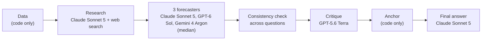

# Midterms forecasting agent

[](https://github.com/pchrysostomou/midterms-forecasting-agent/actions/workflows/tests.yml)


An LLM agent that forecast the 2026 US midterm elections and the next-day market reaction. It won **Best AI Agent Process** at Poros Foundry's *Forecast the Future: US Midterm Election Night Edition* (London, 3 November 2026).

The core idea: several models form a view without seeing the market price for the question, and then code, not a model, decides how far that view may move the answer away from the market.

This repo holds all of my agent code. It runs on top of the organisers' public data kit, which is not included here (see Run it).

## Results

There were three tracks: AI-only, human + AI, and human only. In the AI-only track the agent produces every number. You can change how it works, but you cannot tell it the answer.

| Prize or part | Result |
|---|---|
| Best AI Agent Process | **1st place**, 4.05/5 (AI-only average 3.35) |
| Next-day market moves (10 questions) | 5th overall, 2nd in the AI-only track (scaled error 2.82, lower is better) |
| Election forecasts (15 questions) | 9th overall, 3rd in the AI-only track (-0.29 Brier points per question against the prediction market; 0 means matching it) |

The process score was rated by two judge models, each run twice:

| Component | Weight | Score |
|---|---|---|
| Agent design | 40% | 3.75 |
| Evidence quality | 30% | 3.50 |
| Stability across reruns | 15% | 5.00 |
| Traceability and efficiency | 15% | 5.00 |

## The questions

- **Election questions (A1-A15):** the probability that the Democrat wins 13 Senate and House races, plus control of the House and of the Senate. Scored as Brier gain against the average of Kalshi and Polymarket at the deadline.
- **Market questions (B1-B10):** the move from the 3 November close to the 4 November close for the S&P 500, Russell 2000, NVIDIA, VIX, US 2-year and 10-year yields, the UK 10-year gilt, gold, WTI oil and natural gas. Scored as the error divided by a typical daily move, capped at 5.

## How it works



1. **Data (code):** the live Kalshi and Polymarket odds for each election question, the typical daily move of each asset, and each asset's move after the 2016-2024 elections. The models never have to recall or invent a price.
2. **Research:** one sourced, dated web research brief per question, plus one on the national picture. Any line that names a prediction market is dropped, so no market price reaches the forecasters through the research.
3. **Forecast:** three models from different families forecast each question. On election questions they never see the market price; on market questions the only market odds they see are the House and Senate control odds, used to weight their scenarios. Their median is the agent's own estimate.
4. **Consistency check:** one call looks across all questions, for example Senate control against the individual Senate races.
5. **Critique:** a different model compares the agent's estimate with the market and the evidence, and says how much weight it deserves and why.
6. **Anchor (code):** turns the critique into a number within hard limits (below).
7. **Final:** a model answers with the anchor, cites the evidence and ends with a JSON line. Code checks that the answer equals the anchor and asks again if it does not.

### Election questions: the market is the default

`anchor = market + w x (bias-adjusted own estimate - market)`

- `w` is at most 0.35, and the anchor never moves more than 4 percentage points from the market.
- `w` is 0 unless the critique names a concrete reason the market is wrong that code can confirm in the data: no Kalshi trade for 6+ hours, under 100,000 contracts traded in a week, a Kalshi/Polymarket gap of 3+ points, or a poll whose fieldwork ended after the market's last 2-point move.
- Weak research caps `w` at 0.1.
- The models' shared lean against the market is measured in every run and removed before any move. If the blind estimates lean the same way on at least two thirds of the questions, the run reports it as model bias and does not trade on it.

### Market questions: history only when it agrees

`anchor = W x median past-election move + 0.5 x keep x forecasters' adjustment`, capped at 3 typical daily moves (for the VIX, at its median past-election move if that is larger)

- The past-election move is measured in typical daily moves and rescaled to today's volatility.
- `W` is 0.3 if 4 of the 5 past elections moved the asset the same way, 0.5 if all 5 did, and 0 otherwise. Five elections is a small sample, so the prior only counts when the history agrees.
- `keep` (0 to 1) comes from the critique, so the forecasters' scenario only enters when the critique backs it.
- A leave-one-out backtest (`agent/backtest_b.py`) is inconclusive. With only four past elections left in each test, the result depends on how the "4 of 5" rule is approximated: on the assets where the prior fired, with the 0.3 weight the agent used there, it ranges from slightly better than always forecasting no change (3.05 against 3.09) to worse (3.33). Five elections cannot show that the prior helps.

## What the night showed

- On 10 of the 15 election questions, the models' median forecast differed from the market in the same direction. The agent flagged this as shared model bias and stayed close to the market. By my own calculation, submitting the median forecasts unchanged would have scored -7.4 per question against the market. The agent scored -0.29.
- The judges' main criticism was fair. The critique gave the agent's own forecasts zero weight on 11 of the 15 election questions, and at most 0.12 on the rest, so most answers ended at the market price, and matching the market can never beat it.
- The consistency check correctly flagged that the Senate control forecast did not match the individual Senate races, but nothing in the design could carry that finding into the answer: it reached the critique and the final as a note, and the anchor moves only on a market failure.
- The judges also took points off evidence quality for some Part B scenario sizes without a source, and for a few conflicting figures, such as VIX starting levels.

## What I would change

- Run the critique on live markets for a few weeks before an event, and check whether prices later moved towards the forecasts it blocked. Then tune the gate from that, not from intuition.
- Feed the consistency check back into the anchors, so that chamber control agrees with the race forecasts.
- Require a source for every Part B scenario size, and reconcile conflicting figures before the forecasters see them.

## Engineering

- **Traceability:** every model call goes through the organisers' `ftf.ask()` with a role tag and the git commit, and every prompt and output of a run is saved.
- **Reliability:** a killed or crashed run resumes from its saved stages without repeating a call. Files are written atomically, and a run that stops on an outage resumes itself.
- **Tests:** 96 offline tests (`agent/test_offline.py`, no network, a few seconds) run on every push. A chaos test injected failures, stalls and broken output into 20-60% of model calls, and all 10 seeded runs still ended in a valid dry-run submission.
- **Cost:** the judged run took 152 model calls, $4.64 and 4 minutes 22 seconds.
- **Stability:** reruns of the final step gave identical answers, and two independent full development runs stayed within 1 point (election questions) and 0.02 typical moves (market questions).

The full development and validation log is in [`agent/VALIDATION.md`](agent/VALIDATION.md).

## Run it

The agent runs inside the organisers' public event kit, which holds the data pack and the `ftf` helper. This repo holds only my code.

```bash
git clone https://github.com/poros-foundry/forecast-the-future-2026 kit
git clone https://github.com/pchrysostomou/midterms-forecasting-agent
cp -r midterms-forecasting-agent/agent kit/agent
cd kit
python3 -m venv .venv && source .venv/bin/activate
pip install -r requirements.txt

python agent/test_offline.py   # 96 offline tests, no keys needed
python agent/backtest_b.py     # Part B prior backtest, no keys needed
```

Development runs use your own Anthropic key and can never submit:

```bash
pip install -r ../midterms-forecasting-agent/requirements.txt   # the kit's versions plus anthropic
export ANTHROPIC_API_KEY=...
python agent/agent.py --dev --run d1 --only A1,B4
```

Event runs (`python agent/agent.py --run <label> --submit`) used the event's OpenRouter key, which only worked during the event.

## Repository layout

| File | What it does |
|---|---|
| `agent/agent.py` | The pipeline and its command line |
| `agent/data.py` | The deterministic data step |
| `agent/check_run.py` | Audits a finished run the way a judge would read it |
| `agent/preflight.py` | Catches setup mistakes before an event run, without printing secrets |
| `agent/backtest_b.py` | Leave-one-out backtest of the Part B prior |
| `agent/dev_backend.py` | Development backend on your own Anthropic key; never submits |
| `agent/test_offline.py` | 96 offline tests |
| `agent/VALIDATION.md` | Development runs, stability, crash and chaos tests |

## Notes

- My event repo stays private because it also holds the organisers' data pack and my own run notes. The agent code here is identical, file for file, to the commit that made the judged run (run 3, commit `96fa458`).
- I wrote the code with Claude Code.
- The organisers' data pack is not included. Get it from [their repo](https://github.com/poros-foundry/forecast-the-future-2026).

Thanks to Helen Hu and Poros Foundry for organising Forecast the Future.

## License

[MIT](LICENSE)
